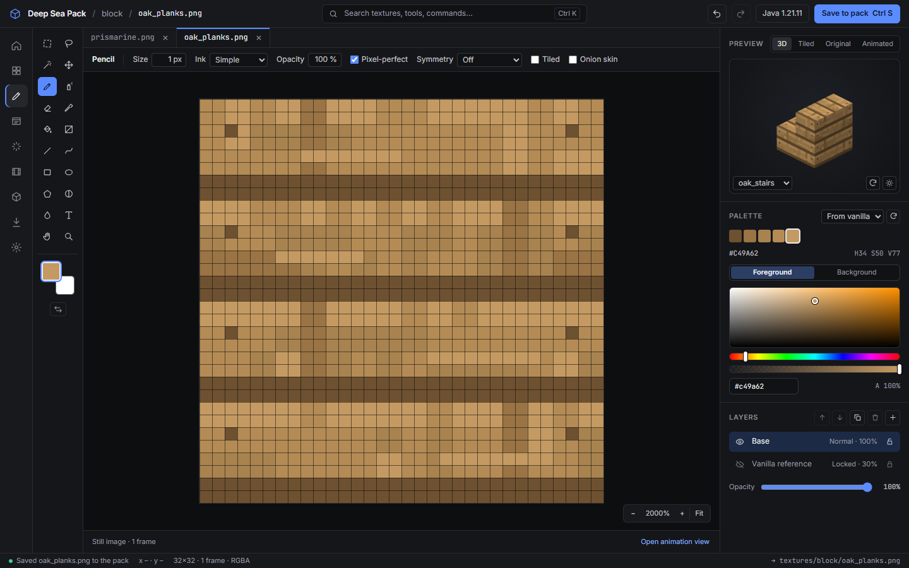
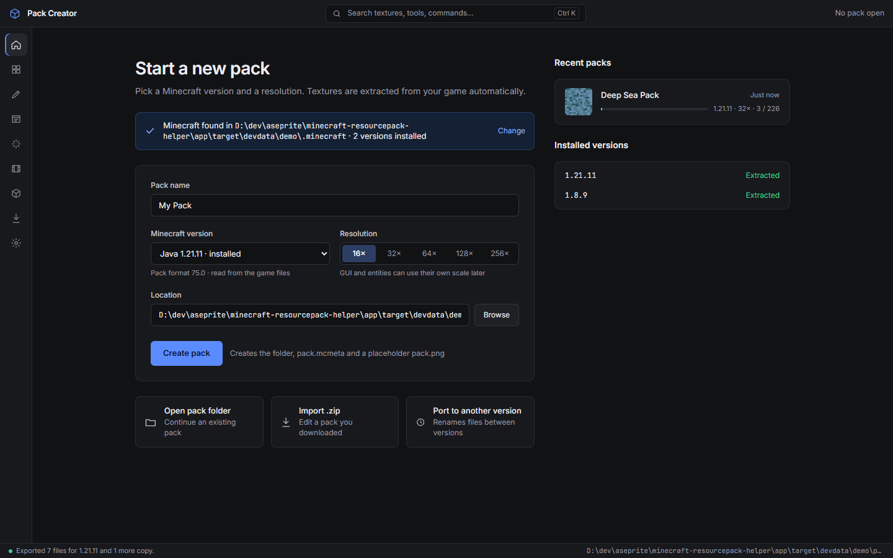
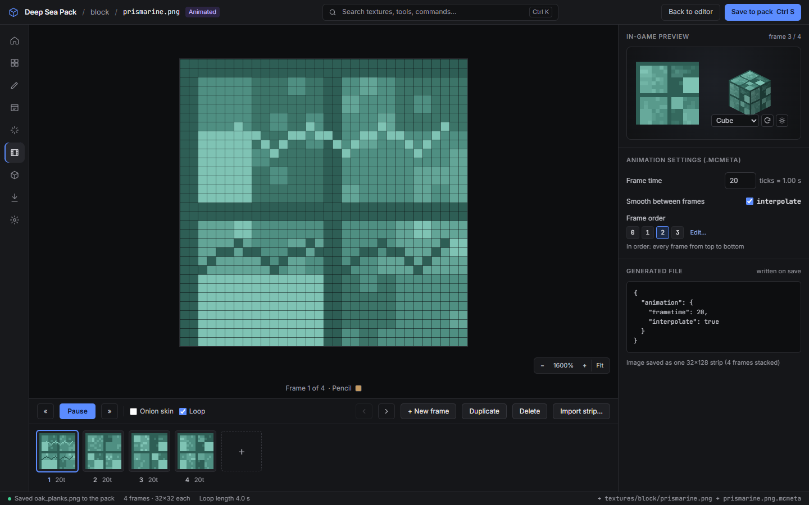
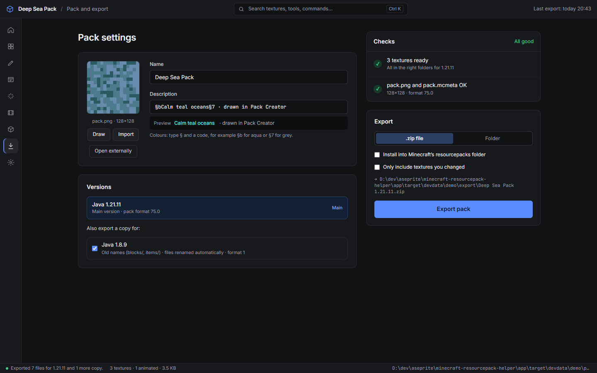

# Pack Creator

Pack Creator is a desktop app for making **Minecraft Java Edition resource
packs** on Windows. It finds the game on your computer, shows every texture of
the version you pick, and lets you redraw them in a built-in pixel editor. You
can animate textures, see blocks in 3D, watch particles move, rework the
interface (buttons, hotbar, hearts…) and export a pack that is ready to use,
also for older versions of the game. You do not need Aseprite or any other
program.



*The screenshots use a fake demo game made by `tools/demo/make_demo_minecraft.py`,
so they contain no Minecraft textures.*

## What each screen does

**Start.** Create a pack (name, game version, resolution 16× to 256×,
folder), reopen a recent pack, open a pack folder or import a `.zip`. The app
shows the Minecraft versions installed on your computer.



**Textures.** Every texture of the version, by category (blocks, items, GUI,
entities, particles…), with search and filters (to do, done, changed since
export, animated, wrong size). The inspector shows the game's texture next to
yours, the block models that use it and its name in older and newer versions.
From here you can edit a texture, import an image (kept pixel for pixel),
open it in another program, or revert it.
"Share list" turns the list into a to-do list you can send to friends or a
team: a checklist for Discord, GitHub or Notion, plain text, or a spreadsheet
file, for the current view or the whole pack, copied or saved as a file.


**Editor.** A pixel editor in the style of Aseprite: pencil, eraser, bucket,
line, shapes, selections, move, gradient, text, symmetry, tiled mode, layers,
a faint vanilla reference layer, a palette taken from the game's texture, and
undo / redo. The preview shows the texture tiled, as it is, animated, or on a
3D block (cube, stairs, slab, plants…) that updates while you draw.

**Animation.** Frames with their own durations, onion skin, playback at the
game's speed, smooth frames ("interpolate"), a custom frame order and import
of a vertical strip. The app writes the `.mcmeta` file for you and shows it.



**Particles.** All particles of the version in a small live scene (night,
day, under water; ¼× to 2× speed; your pack or the game's). For old versions
that keep all particles on one sheet, the app shows which cells belong to a
particle and lets you draw only on those cells.


**Interface.** The game's screens (pause menu, inventory, HUD, title screen,
recipe book, advancements, boss bars) put together from your pack's pieces at
GUI scale 1×, 2× or 3×. Click a piece to select it, double-click to draw on it,
and choose how it stretches (Stretch, Tile or Nine-slice with borders).
Versions before 1.20.2 keep pieces inside shared images; the app shows each
piece's rectangle and lets you draw only inside it.


**Pack and export.** Pack icon (draw or import), name, description with `§`
colour codes, checks with one-click fixes, and export as a `.zip` or a folder.
It can also install the pack into Minecraft's `resourcepacks` folder and make
copies for older versions, with the files renamed automatically.



## Install

1. Get the installer **`Pack Creator_0.1.0_x64-setup.exe`** (it is built into
   `app/target/release/bundle/nsis/` when you build from source, see below).
2. Run it. Windows may warn that the publisher is unknown, because the
   installer is not signed: click "More info", then "Run anyway".
3. Start Pack Creator from the Start menu.

You also need:

- **Windows 10 or 11.** The app uses Microsoft Edge WebView2, which is already
  part of Windows 10 and 11.
- **Minecraft Java Edition**, installed with the official launcher.
- **Each version you want to use started once** in the launcher. The game
  only downloads a version's files when you play it, and Pack Creator reads the
  textures from those files.

## Quick start

1. **Start Pack Creator.** It finds your Minecraft folder by itself (you can
   change it in Settings).
2. **Create a pack.** Type a name, pick a version and a resolution, then click
   "Create pack". The first time, the app copies that version's textures from
   the game (a few seconds).
3. **Find a texture.** In Textures, pick a category or type in the search
   field. Click a row to compare the game's texture with yours.
4. **Draw.** Double-click the texture (or click "Edit texture"). Draw, then
   press **Ctrl+S** to save it into your pack.
5. **Animate (optional).** Click "Open animation view", add frames, set their
   durations and press play. Ctrl+S saves the image and its `.mcmeta`.
6. **Export.** Open "Pack and export", check that the checks are green, tick
   "Install into Minecraft's resourcepacks folder" if you like, and click
   "Export pack".
7. **Play.** In Minecraft, open Options → Resource Packs and turn your pack on.

## Where your files go

- **Your pack folder** (by default `Documents\Minecraft Packs\<pack name>`):
  a normal resource pack with `pack.mcmeta`, `pack.png` and `assets/…`. You can
  open it in any other program.
- **`.packcreator\` inside the pack**: the app's working files (layers, frames,
  palette, and a `trash` folder with the old version of anything you replaced).
  This folder is **never exported**.
- **Exports**: an `export` folder next to the pack (you can change it in
  Settings), and, if you ask, Minecraft's `resourcepacks` folder.
- **App cache** (`%LOCALAPPDATA%\dev.packcreator.app`): the textures copied
  from your installed game, so the app can show them. They stay on your
  computer and are never put into your pack or shipped with the app. You can
  delete this folder at any time; the app copies them again when needed.
- **Settings and recent packs**: `%APPDATA%\dev.packcreator.app\settings.json`.

## Known limitations

See [docs/LIMITATIONS.md](docs/LIMITATIONS.md) for what is not finished yet
and the list of ideas for later.

## Building from source

You need:

- **Rust** (stable, MSVC toolchain), installed with [rustup](https://rustup.rs);
- **Node.js** 20 or newer (LTS) with npm;
- **Microsoft C++ Build Tools** ("Desktop development with C++" in the Visual
  Studio Installer);
- **WebView2** (already part of Windows 10 and 11).

Then, in a terminal:

```
cd app
npm install            # once
npm run tauri dev      # run the app (the first build takes a few minutes)
npx tauri build        # Windows installer in target/release/bundle/nsis/
```

Tests and checks (run them before each commit):

```
cd app
cargo fmt --all --check
cargo clippy --all-targets -- -D warnings
cargo test
npm run check          # typecheck + lint + front-end tests
npm run build          # front-end production build
```

The project is laid out like this:

- `app/core`: the Rust logic (game versions, extraction, packs, `.mcmeta`
  files, renames, export), with its tests and data tables in `app/core/data`;
- `app/src-tauri`: the desktop shell (commands, image protocol, file watcher);
- `app/src`: the user interface (React and TypeScript);
- `docs/`: design, decisions (`DECISIONS.md`), progress (`PROGRESS.md`),
  checked game facts and the mockups;
- `tools/`: developer scripts (research on game files, screenshots of the
  running app, and the demo game used for the README screenshots).

To make the demo game and run the app on it instead of your real game:

```
python tools/demo/make_demo_minecraft.py app/target/devdata/demo/.minecraft
```

then choose that folder in Settings (or see `docs/PROGRESS.md`, "How to run",
for running the app with separate settings).

## The old Aseprite plugin

Before Pack Creator, this repository was an Aseprite extension called
"Minecraft Resource Pack Helper". Its files (`main.lua`, `modules/`,
`package.json`) are kept for reference only and are **no longer maintained**.

## Legal

Pack Creator is not an official Minecraft product. It is not approved by or
associated with Mojang or Microsoft. The app never contains or ships Minecraft
textures: it reads them from the game installed on your own computer.
