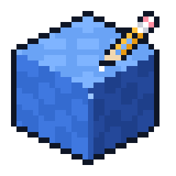
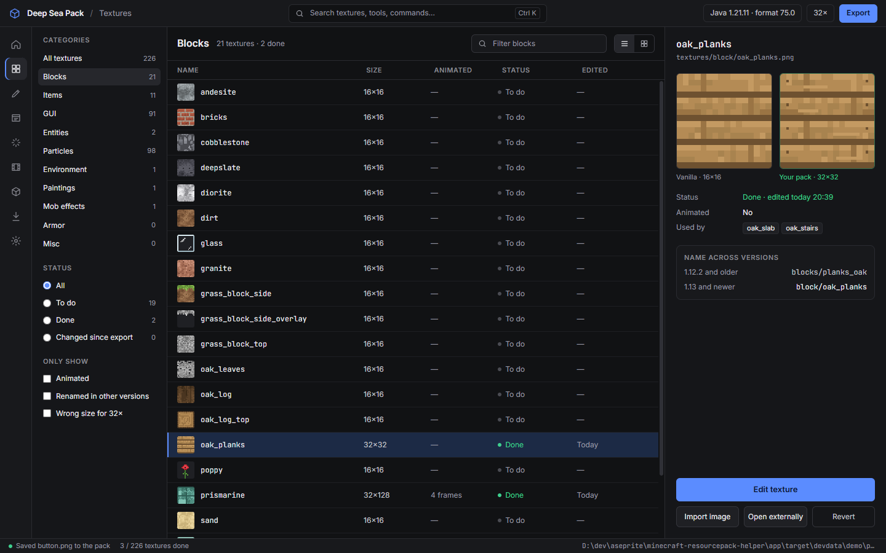
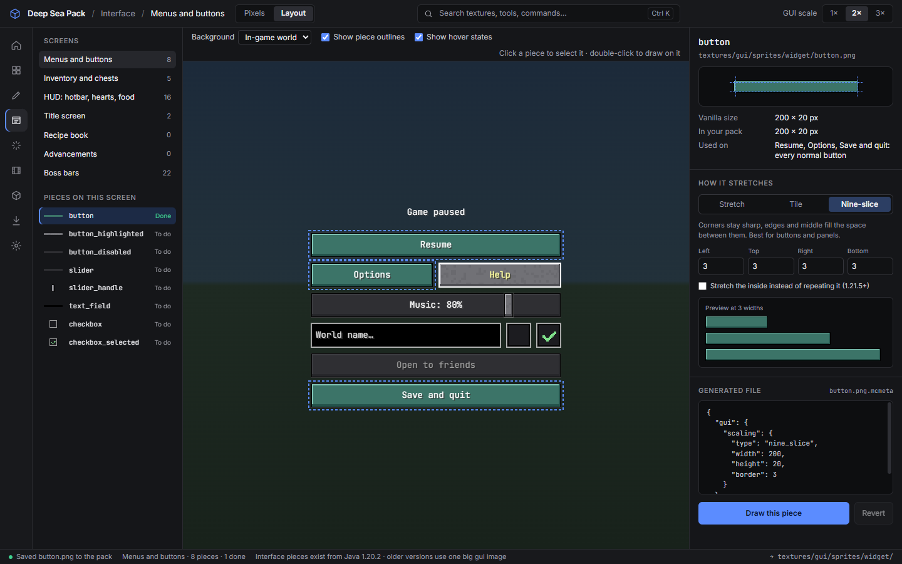
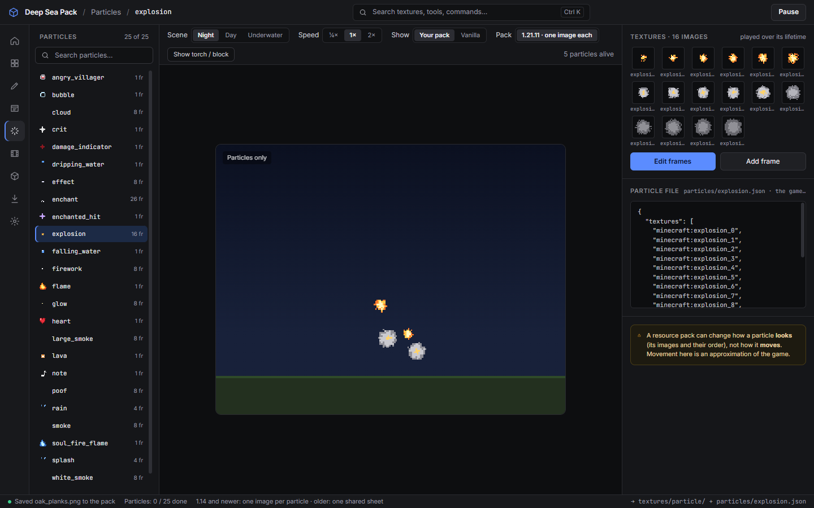

<p align="center">
  
</p>

<h1 align="center">Blockwright</h1>

<p align="center">
  <b>Make Minecraft look like yours.</b><br>
  A free, open-source Windows app for making Minecraft Java Edition resource packs:<br>
  every texture of your game, a pixel editor made for blocks, and a pack that is ready to play.
</p>

<p align="center">
  <a href="https://github.com/AriLeGrand/minecraft-resourcepack-helper/actions/workflows/build.yml"></a>
  <a href="LICENSE"></a>
</p>

<p align="center">
  <a href="#install">Install</a> ·
  <a href="#quick-start">Quick start</a> ·
  <a href="#features">Features</a> ·
  <a href="#where-your-files-go">Your files</a> ·
  <a href="#building-from-source">Build from source</a> ·
  <a href="docs/LIMITATIONS.md">Limitations</a> ·
  <a href="CONTRIBUTING.md">Contributing</a>
</p>


<sub>All screenshots use a fake demo game made by `tools/demo/make_demo_minecraft.py`, so they contain no Minecraft textures.</sub>

## Why Blockwright

- **Every texture, already there.** Blockwright finds Minecraft on your computer and lists every texture of the version you pick, with its status: to do, done, changed since export.
- **Draw without leaving the app.** A pixel editor in the style of Aseprite, with a live 3D block, animation, the game's screens and particles. No other program needed.
- **Any version, 1.8.9 to the newest.** It knows each version's pack format and every texture that was renamed, and can export copies of your pack for older versions.
- **Your work is safe.** Nothing is written until you save, imported images are never resized or changed, and every texture you replace can be restored.
- **No Mojang files inside.** Textures are read from your own game and stay in the app's cache. They are never shipped with the app or put into your pack.

## Install

1. Get the installer **`Blockwright_0.1.0_x64-setup.exe`**: from the
   [Releases](https://github.com/AriLeGrand/minecraft-resourcepack-helper/releases) page,
   from the **Artifacts** of the latest [Build run](https://github.com/AriLeGrand/minecraft-resourcepack-helper/actions/workflows/build.yml),
   or by [building it yourself](#building-from-source).
2. Run it. It installs for your account only, without admin rights. The installer is not signed yet, so
   Windows may say the publisher is unknown: click **More info**, then **Run anyway**.
3. Start **Blockwright** from the Start menu. A short welcome tour shows the basics the first time.

You also need:

| | |
|---|---|
| **Windows 10 or 11** | 64-bit. The app uses Microsoft Edge WebView2, which is part of Windows. |
| **Minecraft Java Edition** | Installed with the official launcher. |
| **Each version you want to use started once** | The launcher only downloads a version's files when you play it, and Blockwright reads the textures from them. |

## Quick start

1. **Create a pack.** Type a name, pick a game version and a resolution (16× to 256×), and click **Create pack**. The first time, the app copies that version's textures from the game (a few seconds).
2. **Find a texture.** In **Textures**, pick a category or search. Click a row to compare the game's texture with yours.
3. **Draw.** Double-click the texture, draw, and press **Ctrl+S** to save it into your pack.
4. **Export.** Open **Pack and export**, make the checks green, tick *Install into Minecraft's resourcepacks folder* if you like, and click **Export pack**.
5. **Play.** In Minecraft, open *Options → Resource Packs* and turn your pack on.

Press **Ctrl+K** anywhere to search textures, screens and commands.

## Features

### Textures

Every texture of the version, by category (blocks, items, GUI, entities, particles…), with search and filters. The inspector shows the game's texture next to yours, the block models that use it, and its name in older and newer versions.

- **Import** an image, kept pixel for pixel, or **open it** in your usual editor (Aseprite, Paint.NET…). The app refreshes when you save there.
- **Batch import** a whole folder (or drop PNGs on the window). Every file is matched to its texture, old names are translated (`planks_oak.png` becomes `block/oak_planks` in a 1.21 pack), and you review the list before anything is written.
- **What's new since…** compares your version with another installed one: new textures, textures Mojang redrew, renamed and removed ones.
- **Notes, tags and "assigned to"** on every texture, with filters by tag or person, and a **Progress** card (percent done overall and per category).
- **Share list** turns any view into a to-do list for Discord, GitHub or Notion, plain text or a spreadsheet, optionally grouped by person.
- **History** keeps every earlier version of a texture and restores any of them.



### Editor

Pencil, eraser, bucket, line, shapes, selections, move, gradient, text, symmetry and tiled mode, with layers, undo and a faint vanilla reference layer. The preview shows the texture tiled, as it is, animated, or on a 3D block (cube, stairs, slab, plants…) that updates while you draw.

- A **pack palette** shared by every texture, with *Snap to pack palette* and an export check for colours outside it.
- **Recolour** a whole set of textures at once (hue, saturation, brightness, contrast or colour mapping) with previews and Undo.
- **Make variants** of a texture's family: oak planks into spruce, birch, cherry…
- A **seam check** when a block texture's edges show in the tiled preview.
- A smooth **Scale2x / Scale3x** start for 32× packs and up (Settings).
- Copy and paste with other programs through the Windows clipboard.

### Animation

Frames with their own durations, onion skin, playback at the game's speed, smooth frames (*interpolate*), a custom frame order and import of a vertical strip. The `.mcmeta` file is written for you.


### Scene

A small diorama in 3D with your pack's textures, including unsaved edits: a little house, a 4×4 wall to check seams, a garden, or your own scene of up to 8×8×4 blocks, saved with the pack. Day, sunset or night, block light 0–15 like the game, and ambient occlusion. Click a block to open its textures.

### Interface

The game's screens (pause menu, inventory, HUD, title screen, recipe book, advancements, boss bars) put together from your pack's pieces at GUI scale 1×, 2× or 3×. Click a piece to select it, double-click to draw on it, and choose how it stretches: *Stretch*, *Tile* or *Nine-slice*. Before 1.20.2, where pieces share one image, you draw only inside each piece's rectangle.



### Particles

All particles of the version in a live scene (night, day, under water; ¼× to 2× speed; your pack or the game's). For old versions with a single particle sheet, you see and draw only the cells a particle uses.



### Variety

- **Random variants**, built into the game: give a block several looks with weights (1–100) and an optional random turn. A 3D patch shows a random pick.
- **Connected textures** for the OptiFine or Continuity mod: the 5 compact tiles and the `.properties` file, with a live preview of how they join.

### Pack and export

Pack icon, name, description with `§` colour codes, and checks with one-click fixes. Export as a `.zip` or a folder.

- **Install** straight into Minecraft's `resourcepacks` folder.
- **Copies for older versions**, with every file renamed.
- **Smaller PNG files** with exactly the same pixels.
- A 1920×1080 **showcase image** and **page text** for CurseForge or Modrinth.
- **Compare with another pack**, side by side with yours and the game's, and copy the textures you tick.


## Where your files go

| What | Where |
|---|---|
| **Your pack** | A normal resource pack folder (by default `Documents\Minecraft Packs\<pack name>`) with `pack.mcmeta`, `pack.png` and `assets/…`. Open it in any program. |
| **The app's working files** | `.packcreator\` inside the pack: project settings, layers and frames, notes, the scene, the history of replaced textures and a `trash` folder. **Never exported.** |
| **Exports** | An `export` folder next to the pack (change it in Settings) and, if you ask, Minecraft's `resourcepacks` folder. |
| **Game textures** | `%LOCALAPPDATA%\dev.packcreator.app`: copied from your installed game so the app can show them. Never put into your pack; safe to delete at any time. |
| **Settings and recent packs** | `%APPDATA%\dev.packcreator.app\settings.json` |

The app was first called *Pack Creator*; the folder names above keep that name so nothing moves when you update.

## Known limitations

Blockwright is a preview. Windows only for now; the installer is not signed; several features (connected textures, the newest pack formats) are checked against the game's files but not yet in the game itself. The full list, and the ideas for later, are in [docs/LIMITATIONS.md](docs/LIMITATIONS.md).

## Building from source

You need **Rust** (stable, MSVC toolchain, via [rustup](https://rustup.rs)), **Node.js** 20 or newer with npm, and the **Microsoft C++ Build Tools** (*Desktop development with C++* in the Visual Studio Installer).

```powershell
cd app
npm install          # once
npm run tauri dev    # run the app (the first build takes a few minutes)
npx tauri build      # installer in app/target/release/bundle/nsis/
```

Checks to run before each commit:

```powershell
cd app
cargo fmt --all --check
cargo clippy --workspace --all-targets -- -D warnings
cargo test --workspace
npm run check        # type check, lint and front-end tests
npm run build        # front-end production build
```

Every push and pull request to `main` runs the same checks on GitHub and builds the installer ([`.github/workflows/build.yml`](.github/workflows/build.yml)).

To try the app without your real game, make the demo game and choose its folder in Settings:

```powershell
python tools/demo/make_demo_minecraft.py app/target/devdata/demo/.minecraft
```

### Project layout

| Folder | What is in it |
|---|---|
| `app/core` | The Rust logic (game versions, extraction, packs, `.mcmeta`, renames, export…) with its tests; data tables in `app/core/data`. |
| `app/src-tauri` | The desktop shell: commands, image protocol, file watcher, window. |
| `app/src` | The interface (React and TypeScript). |
| `site/` | The presentation website (plain HTML, CSS and JavaScript); see [site/README.md](site/README.md). |
| `docs/` | [Decisions](docs/DECISIONS.md), [progress](docs/PROGRESS.md), [limitations](docs/LIMITATIONS.md), [checked game facts](docs/research/domain-facts.md), design and mockups. |
| `tools/` | Developer scripts: game-file research, app screenshots and the demo game. |

## Contributing

Bug reports, ideas and pull requests are welcome. Please read
[CONTRIBUTING.md](CONTRIBUTING.md) first: it has the ground rules (above all,
never commit Minecraft's own files), the setup and the checks to run. Report
bugs and suggest ideas with the
[issue forms](https://github.com/AriLeGrand/minecraft-resourcepack-helper/issues/new/choose).

## License

Blockwright is open source under the [MIT License](LICENSE): you can use,
change and share it freely, including in your own projects, as long as the
license notice stays with it.

## The old Aseprite plugin

Before Blockwright, this repository was an Aseprite extension called *Minecraft Resource Pack Helper*. Its files (`main.lua`, `modules/`, `package.json`) are kept for reference only and are **no longer maintained**.

## Legal

Blockwright is not an official Minecraft product. It is not approved by or associated with Mojang or Microsoft. The app never contains or ships Minecraft textures: it reads them from the game installed on your own computer.
